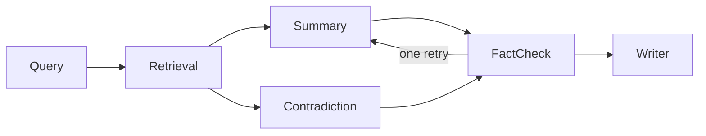

# Academic Research Assistant Team

Six agents turn a research question into a short, sourced literature summary. A claim stays in the summary only when a passage retrieved from the local papers supports it. The coordinator is a [Microsoft Agent Framework](https://learn.microsoft.com/en-us/agent-framework/) workflow. Each agent is one executor module. One `ResearchDossier` is the blackboard: every agent reads that object and writes its own fields. Chat goes through the Gemini Developer API. `OpeningDraft` only starts Summary and Contradiction together. It is not a seventh analyst.

A workflow fits because the steps are ordered, two of them can run at the same time, and the critic has one branch back to Summary. A blackboard fits because later agents need the earlier writes, and a private copy would let those writes drift. RAG fits because the passages are chunks of the supplied papers, and the fact-check gate refuses anything that is not copied from them.



`architecture.svg` is the same picture with the two tools on each agent.

## Roster

| Agent | Module | Tools | Writes on the dossier |
| --- | --- | --- | --- |
| Query | `agents/query_agent.py` | `list_corpus_titles`, `commit_subqueries` | 3–5 sub-queries over the paper titles |
| Retrieval | `agents/retrieval_agent.py` | `embed_subqueries`, `store_retrieved_passages` | passages for those sub-queries |
| Summary | `agents/summary_agent.py` | `read_passages_for_summary`, `commit_claims` | themed claims that name passage ids |
| Contradiction | `agents/contradiction_agent.py` | `read_passages_for_contradictions`, `commit_contradictions` | disagreements, or a note that none qualified |
| Fact-check | `agents/factcheck_agent.py` | `select_checkable_claims`, `commit_verdicts` | verdicts, and one retry flag |
| Writer | `agents/writer_agent.py` | `draft_supported_overview`, `publish_report` | the markdown report, with no model call |

The tools are plain Python functions wrapped as Agent Framework tools. The agent calls both on every visit. Summary's second visit does not repeat Contradiction.

## Memory and retrieval

The dossier holds the question, sub-queries, passages, claims, contradictions, verdicts, the dropped-claim log, and the report. The passage index holds one chunk per paper section and, when the embedding call works, one document vector per chunk. Ranking is `0.65 * max(cosine, 0) + 0.35 * lexical overlap`. Document embeddings use Gemini `RETRIEVAL_DOCUMENT`. Query embeddings use `RETRIEVAL_QUERY`. Only Retrieval reads the index.

## Honest failure

The fact-check model can mark a claim supported and attach a quote that is not in the cited passage. `commit_verdicts` drops that verdict. The claim is listed under dropped claims, and a rewrite is allowed only once. The model cannot restore it. A question the papers never mention, or a search that returns no passage, stops the run instead of inventing a source. Both stops are appended to `logs/run.log`. The file is only ever opened for append.

## Setup and run

Python 3.10 or newer. From this directory: `uv sync --extra dev`, then `cp .env.example .env`. Set `GOOGLE_API_KEY` (`GEMINI_API_KEY` is accepted). `GOOGLE_MODEL` defaults to `gemini-3.5-flash`, then `gemini-3.5-flash-lite` and `gemini-3.1-flash-lite` if Gemini is busy. `GOOGLE_EMBEDDING_MODEL` defaults to `gemini-embedding-2`.

```bash
uv run python -m research_assistant "Does retrieval-augmented generation reduce unsupported claims in scientific question answering?"
```

The command prints the summary, writes `outputs/<run_id>.md` and `outputs/<run_id>.json`, and appends `logs/run.log`. `--corpus PATH` selects another directory of `.md` or `.txt` papers. `uv run python -m research_assistant.ui` serves the same pipeline at <http://127.0.0.1:8765>.

`corpus/` has six short papers. Iyer 2025 reports that showing passages did not reduce unsupported claims. Okonkwo 2025 reports that requiring a passage id and a quote cut that rate from 31 percent to 6 percent.

## Demo, diagram, log, tests

`demo.ipynb` runs the workflow on two provided papers with a scripted model, so the trace does not need an API key. Run all cells, or `uv run python -m research_assistant.demo`. It prints each agent's tool calls, the summary, and the uncovered-question stop. `architecture.svg` is the diagram. `logs/run.log` is the append-only JSONL log. `uv run pytest` includes `tests/test_scenarios.py`: a supported summary, the critic's one retry, and the two stops against that log.

# Source code

## `src/research_assistant/agents/query_agent.py`

```python
"""Query agent: turn a research question into corpus sub-queries."""

from __future__ import annotations

import json

from agent_framework import Executor, WorkflowContext, handler, tool
from pydantic import BaseModel, Field

from research_assistant.blackboard import get_bindings, invoke, use_shared
from research_assistant.llm import Completer
from research_assistant.memory.dossier import ResearchDossier
from research_assistant.rag.corpus import Paper

_INSTRUCTIONS = """You write search sub-queries for a closed set of research papers.
Use only the research question and the paper titles. Do not answer the question.
Do not search the open web. Return between 3 and 5 short sub-queries that could
match passages in this paper set, including wording that might surface a disagreement.
"""


class QueryDraft(BaseModel):
    sub_queries: list[str] = Field(default_factory=list)


@tool
def list_corpus_titles() -> str:
    """Read the closed paper titles for this run. Does not search the web."""
    papers = get_bindings().papers
    if not papers:
        return "(no papers)"
    return "\n".join(f"- {paper.title}" for paper in papers)


@tool
def commit_subqueries(raw_json: str) -> str:
    """Normalize 3 to 5 sub-queries and write them on the shared dossier."""
    dossier = get_bindings().dossier
    raw = json.loads(raw_json)
    if not isinstance(raw, list):
        raise ValueError("sub-queries must be a JSON list.")
    dossier.sub_queries = normalize_subqueries(dossier.question, [str(item) for item in raw])
    return " | ".join(dossier.sub_queries)


class QueryAgent(Executor):
    """Produces 3–5 sub-queries over the provided paper set."""

    def __init__(self, completer: Completer, papers: list[Paper]) -> None:
        super().__init__(id="query")
        self._completer = completer
        self._papers = papers

    @handler
    async def expand(self, dossier: ResearchDossier, ctx: WorkflowContext[ResearchDossier]) -> None:
        dossier = use_shared(dossier, papers=self._papers)
        titles = await invoke("query", list_corpus_titles)
        prompt = (
            f"Research question:\n{dossier.question}\n\n"
            f"Paper titles:\n{titles}\n\n"
            "Return JSON with a sub_queries array of 3 to 5 strings."
        )
        draft = await self._completer.complete(
            name="query",
            instructions=_INSTRUCTIONS,
            prompt=prompt,
            response_format=QueryDraft,
        )
        await invoke("query", commit_subqueries, raw_json=json.dumps(draft.sub_queries))
        await ctx.send_message(dossier)


def normalize_subqueries(question: str, raw: list[str]) -> list[str]:
    """Keep at most five unique queries, and pad to three with corpus-local fallbacks."""
    cleaned: list[str] = []
    seen: set[str] = set()
    for item in raw:
        text = " ".join(item.split())
        key = text.lower()
        if not text or key in seen:
            continue
        seen.add(key)
        cleaned.append(text)
        if len(cleaned) == 5:
            break
    fallbacks = [
        question.strip(),
        f"evidence that supports: {question.strip()}",
        f"evidence that disagrees: {question.strip()}",
    ]
    for item in fallbacks:
        if len(cleaned) >= 3:
            break
        key = item.lower()
        if item and key not in seen:
            seen.add(key)
            cleaned.append(item)
    if not cleaned:
        cleaned.append(question.strip() or "research question")
    return cleaned[:5]
```

## `src/research_assistant/agents/retrieval_agent.py`

```python
"""Retrieval agent: the only step that reads the passage index."""

from __future__ import annotations

import asyncio
from typing import Protocol

from agent_framework import Executor, WorkflowContext, handler, tool

from research_assistant.blackboard import get_bindings, invoke, use_shared
from research_assistant.memory.dossier import Passage, ResearchDossier
from research_assistant.rag.index import PassageIndex


class QueryEmbedder(Protocol):
    async def embed_query(self, text: str) -> list[float] | None: ...

    async def embed_queries(self, texts: list[str]) -> list[list[float] | None]: ...


class RetrievalError(RuntimeError):
    """Raised when retrieval cannot ground the question in the corpus."""


@tool
async def embed_subqueries() -> str:
    """Embed every sub-query. On failure, leave lexical ranking in place."""
    bindings = get_bindings()
    queries = list(bindings.dossier.sub_queries)
    if not queries:
        bindings.query_vectors = []
        return "no sub-queries"
    embedder = bindings.embedder
    if embedder is None:
        bindings.query_vectors = [None] * len(queries)
        return "lexical fallback"
    try:
        embed_queries = getattr(embedder, "embed_queries", None)
        if embed_queries is not None:
            vectors = await embed_queries(queries)
            if len(vectors) != len(queries):
                vectors = list(await asyncio.gather(*(embedder.embed_query(query) for query in queries)))
        else:
            vectors = list(await asyncio.gather(*(embedder.embed_query(query) for query in queries)))
    except Exception:
        bindings.query_vectors = [None] * len(queries)
        return "lexical fallback"
    bindings.query_vectors = list(vectors)
    if all(vector is None for vector in vectors):
        return "lexical fallback"
    ready = sum(vector is not None for vector in vectors)
    return f"embedded {ready} of {len(queries)}"


@tool
def store_retrieved_passages() -> str:
    """Search the passage index and write the hits onto the shared dossier."""
    bindings = get_bindings()
    dossier = bindings.dossier
    if not dossier.sub_queries:
        raise RetrievalError("The query agent produced no sub-queries, so retrieval cannot run.")
    if bindings.query_vectors is None:
        raise RetrievalError("embed_subqueries must run before the passage search.")
    index = bindings.index
    if not isinstance(index, PassageIndex):
        raise RetrievalError("No passage index is loaded.")
    vectors = bindings.query_vectors
    if len(vectors) != len(dossier.sub_queries):
        vectors = [None] * len(dossier.sub_queries)
    best: dict[str, tuple[Passage, float]] = {}
    for query, vector in zip(dossier.sub_queries, vectors, strict=True):
        for passage, score in index.search(query, bindings.top_k, vector):
            current = best.get(passage.passage_id)
            if current is None or score > current[1]:
                best[passage.passage_id] = (passage, score)
    if not best:
        raise RetrievalError(
            "Retrieval found no passages for the sub-queries. "
            "The assistant will not invent sources."
        )
    ordered = [item[0] for item in sorted(best.values(), key=lambda item: (-item[1], item[0].passage_id))]
    dossier.passages = ordered
    return f"{len(ordered)} passages: " + ", ".join(passage.passage_id for passage in ordered)


class RetrievalAgent(Executor):
    """Fetches relevant passages for each sub-query and stores them on the dossier."""

    def __init__(
        self,
        index: PassageIndex,
        *,
        top_k: int = 4,
        embedder: QueryEmbedder | None = None,
    ) -> None:
        super().__init__(id="retrieval")
        self._index = index
        self._top_k = top_k
        self._embedder = embedder

    @handler
    async def retrieve(self, dossier: ResearchDossier, ctx: WorkflowContext[ResearchDossier]) -> None:
        dossier = use_shared(
            dossier,
            index=self._index,
            embedder=self._embedder,
            top_k=self._top_k,
            query_vectors=None,
        )
        await invoke("retrieval", embed_subqueries)
        await invoke("retrieval", store_retrieved_passages)
        await ctx.send_message(dossier)
```

## `src/research_assistant/agents/summary_agent.py`

```python
"""Summary agent: themed claims that must cite retrieved passage ids."""

from __future__ import annotations

import json

from agent_framework import Executor, WorkflowContext, handler, tool
from pydantic import BaseModel, Field

from research_assistant.agents.context import format_passages
from research_assistant.blackboard import get_bindings, invoke, use_shared
from research_assistant.llm import Completer
from research_assistant.memory.dossier import Claim, ResearchDossier

_INSTRUCTIONS = """You write a short literature summary as discrete claims grouped by theme.
Every claim must be supported by one or more passage ids copied from the retrieved set.
Do not use outside knowledge. Do not cite a passage that is not in the prompt.
If critic notes are present, rewrite the summary: drop rejected claims unless a retrieved
passage now supports a corrected wording, and do not repeat a rejected claim unchanged.
"""


class ClaimDraft(BaseModel):
    theme: str
    text: str
    passage_ids: list[str] = Field(default_factory=list)


class SummaryDraft(BaseModel):
    claims: list[ClaimDraft] = Field(default_factory=list)


@tool
def read_passages_for_summary() -> str:
    """Read the passages stored on the shared dossier."""
    return format_passages(get_bindings().dossier.passages) or "(no passages)"


@tool
def commit_claims(claims_json: str) -> str:
    """Replace the dossier claims with this draft and clear stale verdicts."""
    dossier = get_bindings().dossier
    raw = json.loads(claims_json)
    if not isinstance(raw, list):
        raise ValueError("claims must be a JSON list.")
    claims: list[Claim] = []
    for index, item in enumerate(raw, start=1):
        text = " ".join(str(item.get("text", "")).split())
        if not text:
            continue
        passage_ids = item.get("passage_ids") or []
        claims.append(
            Claim(
                claim_id=f"c{index}",
                theme=str(item.get("theme", "")).strip() or "General",
                text=text,
                passage_ids=list(dict.fromkeys(str(passage_id) for passage_id in passage_ids)),
            )
        )
    dossier.claims = claims
    dossier.verdicts = []
    dossier.needs_revision = False
    return f"{len(claims)} claims"


class SummaryAgent(Executor):
    """Writes structured claims. On a critic retry it rewrites from the notes."""

    def __init__(self, completer: Completer) -> None:
        super().__init__(id="summary")
        self._completer = completer

    async def apply(self, dossier: ResearchDossier) -> ResearchDossier:
        """Write claims onto the shared dossier. Safe beside the contradiction check."""
        dossier = use_shared(dossier)
        passages = await invoke("summary", read_passages_for_summary)
        draft = await self._completer.complete(
            name="summary",
            instructions=_INSTRUCTIONS,
            prompt=_prompt(dossier, passages),
            response_format=SummaryDraft,
        )
        payload = [
            {"theme": item.theme, "text": item.text, "passage_ids": item.passage_ids}
            for item in draft.claims
        ]
        await invoke("summary", commit_claims, claims_json=json.dumps(payload))
        return dossier

    @handler
    async def summarize(self, dossier: ResearchDossier, ctx: WorkflowContext[ResearchDossier]) -> None:
        await ctx.send_message(await self.apply(dossier))


def _prompt(dossier: ResearchDossier, passages: str) -> str:
    parts = [
        f"Research question:\n{dossier.question}",
        "",
        "Retrieved passages:",
        passages,
        "",
        "Return JSON claims. Each claim has theme, text, and passage_ids.",
    ]
    if dossier.revision_count > 0 and dossier.critic_notes:
        notes = "\n".join(f"- {note}" for note in dossier.critic_notes)
        parts.extend(
            [
                "",
                "This is a revision. The fact-check critic rejected these claims:",
                notes,
                "Do not restate a rejected claim unless a retrieved passage supports the new wording.",
            ]
        )
    return "\n".join(parts)
```

## `src/research_assistant/agents/contradiction_agent.py`

```python
"""Contradiction agent: report where two retrieved sources disagree."""

from __future__ import annotations

import json

from agent_framework import Executor, WorkflowContext, handler, tool
from pydantic import BaseModel, Field

from research_assistant.agents.context import format_passages
from research_assistant.blackboard import get_bindings, invoke, use_shared
from research_assistant.grounding import grounded_contradictions
from research_assistant.llm import Completer
from research_assistant.memory.dossier import Contradiction, ResearchDossier

_INSTRUCTIONS = """You compare retrieved passages and report direct disagreements.
A disagreement means two passages take opposed positions on the same point.
Each position must cite passage ids from the prompt, and the two sides must use
different ids. Copy quote_a from a passage cited by side A and quote_b from a
passage cited by side B. Each quote must be a contiguous span of at least 20
characters. If the passages do not disagree, return an empty list.
Do not invent a dispute, and do not use knowledge from outside the passages.
"""


class ContradictionDraft(BaseModel):
    topic: str
    position_a: str
    passage_ids_a: list[str] = Field(default_factory=list)
    quote_a: str = ""
    position_b: str
    passage_ids_b: list[str] = Field(default_factory=list)
    quote_b: str = ""


class ContradictionReport(BaseModel):
    contradictions: list[ContradictionDraft] = Field(default_factory=list)


@tool
def read_passages_for_contradictions() -> str:
    """Read the passages stored on the shared dossier."""
    return format_passages(get_bindings().dossier.passages) or "(no passages)"


@tool
def commit_contradictions(proposed_json: str) -> str:
    """Keep only disagreements whose quotes are copied from the cited passages."""
    dossier = get_bindings().dossier
    raw = json.loads(proposed_json)
    if not isinstance(raw, list):
        raise ValueError("contradictions must be a JSON list.")
    proposed: list[Contradiction] = []
    for item in raw:
        position_a = " ".join(str(item.get("position_a", "")).split())
        position_b = " ".join(str(item.get("position_b", "")).split())
        if not position_a or not position_b:
            continue
        proposed.append(
            Contradiction(
                topic=str(item.get("topic", "")).strip() or "Disagreement",
                position_a=position_a,
                passage_ids_a=list(dict.fromkeys(str(value) for value in item.get("passage_ids_a") or [])),
                quote_a=" ".join(str(item.get("quote_a", "")).split()),
                position_b=position_b,
                passage_ids_b=list(dict.fromkeys(str(value) for value in item.get("passage_ids_b") or [])),
                quote_b=" ".join(str(item.get("quote_b", "")).split()),
            )
        )
    kept, note = grounded_contradictions(dossier, proposed)
    dossier.contradictions = kept
    dossier.contradiction_note = note
    if not kept:
        return note or "no contradiction"
    return f"{len(kept)} contradictions"


class ContradictionAgent(Executor):
    """Finds opposed positions and drops any pair that is not grounded."""

    def __init__(self, completer: Completer) -> None:
        super().__init__(id="contradiction")
        self._completer = completer

    async def apply(self, dossier: ResearchDossier) -> ResearchDossier:
        """Find disagreements on the shared dossier. Depends only on retrieved passages."""
        dossier = use_shared(dossier)
        passages = await invoke("contradiction", read_passages_for_contradictions)
        draft = await self._completer.complete(
            name="contradiction",
            instructions=_INSTRUCTIONS,
            prompt=(
                f"Research question:\n{dossier.question}\n\n"
                f"Retrieved passages:\n{passages}\n\n"
                "Return JSON with a contradictions array. Each item has topic, position_a, "
                "passage_ids_a, quote_a, position_b, passage_ids_b, and quote_b. "
                "Copy each quote from the passage ids on that side."
            ),
            response_format=ContradictionReport,
        )
        payload = [item.model_dump() for item in draft.contradictions]
        await invoke("contradiction", commit_contradictions, proposed_json=json.dumps(payload))
        return dossier

    @handler
    async def compare(self, dossier: ResearchDossier, ctx: WorkflowContext[ResearchDossier]) -> None:
        await ctx.send_message(await self.apply(dossier))
```

## `src/research_assistant/agents/factcheck_agent.py`

```python
"""Fact-check agent: the critic. Verdicts are gated by retrieved passages."""

from __future__ import annotations

import json
from typing import Literal

from agent_framework import Executor, WorkflowContext, handler, tool
from pydantic import BaseModel, Field

from research_assistant.agents.context import format_passages
from research_assistant.blackboard import get_bindings, invoke, use_shared
from research_assistant.grounding import mark_revision, merge_verdicts, partition_claims
from research_assistant.llm import Completer
from research_assistant.memory.dossier import Claim, ResearchDossier, Verdict

_INSTRUCTIONS = """You fact-check literature claims against the retrieved passages only.
Mark a claim supported only when a cited passage entails it, and copy a contiguous
quote of at least 20 characters from that passage into supporting_quote.
If the passage does not entail the claim, mark it unsupported and explain why.
Do not use outside knowledge. Do not invent a quote.
"""


class VerdictDraft(BaseModel):
    claim_id: str
    verdict: Literal["supported", "unsupported"]
    reason: str
    supporting_quote: str = ""


class FactCheckDraft(BaseModel):
    verdicts: list[VerdictDraft] = Field(default_factory=list)


@tool
def select_checkable_claims() -> str:
    """Split claims into those a model may judge and those the passage gate already rejects."""
    eligible, rejected = partition_claims(get_bindings().dossier)
    return json.dumps(
        {
            "eligible": [claim.model_dump() for claim in eligible],
            "pre_rejected": [verdict.model_dump() for verdict in rejected],
        }
    )


@tool
def commit_verdicts(review_json: str, verdicts_json: str) -> str:
    """Apply the quote gate and write verdicts on the shared dossier."""
    bindings = get_bindings()
    dossier = bindings.dossier
    review = json.loads(review_json)
    proposed = json.loads(verdicts_json)
    model_verdicts = [Verdict.model_validate(item) for item in proposed]
    pre_rejected = [Verdict.model_validate(item) for item in review.get("pre_rejected", [])]
    dossier.verdicts = merge_verdicts(dossier, model_verdicts, pre_rejected)
    mark_revision(dossier, bindings.revision_cap)
    supported = sum(verdict.verdict == "supported" for verdict in dossier.verdicts)
    state = "revision requested" if dossier.needs_revision else "accepted"
    return f"{state}; {supported} supported"


class FactCheckAgent(Executor):
    """Verifies each claim and flags a single summary revision when needed."""

    def __init__(self, completer: Completer, *, revision_cap: int = 1) -> None:
        super().__init__(id="factcheck")
        self._completer = completer
        self._revision_cap = revision_cap

    @handler
    async def check(self, dossier: ResearchDossier, ctx: WorkflowContext[ResearchDossier]) -> None:
        dossier = use_shared(dossier, revision_cap=self._revision_cap)
        review_json = await invoke("factcheck", select_checkable_claims)
        review = json.loads(review_json)
        eligible = [Claim.model_validate(item) for item in review["eligible"]]
        model_verdicts: list[dict[str, str]] = []
        if eligible:
            draft = await self._completer.complete(
                name="factcheck",
                instructions=_INSTRUCTIONS,
                prompt=_prompt(dossier, eligible),
                response_format=FactCheckDraft,
            )
            model_verdicts = [
                {
                    "claim_id": item.claim_id,
                    "verdict": item.verdict,
                    "reason": item.reason.strip() or "No reason given.",
                    "supporting_quote": item.supporting_quote.strip(),
                }
                for item in draft.verdicts
            ]
        await invoke(
            "factcheck",
            commit_verdicts,
            review_json=review_json,
            verdicts_json=json.dumps(model_verdicts),
        )
        await ctx.send_message(dossier)


def _prompt(dossier: ResearchDossier, claims: list[Claim]) -> str:
    claim_lines = "\n".join(
        f"- {claim.claim_id} [{', '.join(claim.passage_ids)}] ({claim.theme}): {claim.text}"
        for claim in claims
    )
    return (
        f"Research question:\n{dossier.question}\n\n"
        f"Retrieved passages:\n{format_passages(dossier.passages)}\n\n"
        f"Claims to check:\n{claim_lines}\n\n"
        "Return JSON with a verdicts array. Use the claim_id values above. "
        "supporting_quote must be copied from a cited passage when the verdict is supported."
    )
```

## `src/research_assistant/agents/writer_agent.py`

```python
"""Writer agent: final summary built from supported claims, without another model call."""

from __future__ import annotations

from agent_framework import Executor, WorkflowContext, handler, tool

from research_assistant.blackboard import get_bindings, invoke, use_shared
from research_assistant.memory.dossier import ResearchDossier
from research_assistant.reporting import render_markdown


@tool
def draft_supported_overview() -> str:
    """Build the overview from supported claims only. Does not call a model."""
    return overview_from_claims(get_bindings().dossier)


@tool
def publish_report(overview: str) -> str:
    """Write the markdown report onto the shared dossier."""
    dossier = get_bindings().dossier
    dossier.report_markdown = render_markdown(dossier, overview)
    return f"{len(dossier.report_markdown)} characters"


class WriterAgent(Executor):
    """Publishes the report from verdicts. The overview is the supported claims."""

    def __init__(self) -> None:
        super().__init__(id="writer")

    @handler
    async def write(self, dossier: ResearchDossier, ctx: WorkflowContext[None, ResearchDossier]) -> None:
        dossier = use_shared(dossier)
        overview = await invoke("writer", draft_supported_overview)
        await invoke("writer", publish_report, overview=overview)
        await ctx.yield_output(dossier)


def overview_from_claims(dossier: ResearchDossier) -> str:
    """One sentence per supported claim. No model call, so no new facts."""
    supported = dossier.supported_claims()
    if not supported:
        return "No claim survived fact-checking against the retrieved passages."
    return " ".join(f"{claim.text.rstrip('.')}." for claim in supported)
```

# Test file

## `tests/test_scenarios.py`

```python
"""Three scenarios for the shared-dossier workflow.

1. A covered question runs all six agents, and each agent calls two tools on one dossier.
2. The critic rejects an unquoted claim, summary runs once more, and the claim stays dropped.
3. A question outside the papers stops before the agents, and a search with no hits stops
   after the retrieval tools. The run log is only appended to.
"""

from __future__ import annotations

import inspect
import json
from pathlib import Path

import pytest

from research_assistant.agents.contradiction_agent import (
    commit_contradictions,
    read_passages_for_contradictions,
)
from research_assistant.agents.factcheck_agent import commit_verdicts, select_checkable_claims
from research_assistant.agents.query_agent import commit_subqueries, list_corpus_titles
from research_assistant.agents.retrieval_agent import (
    RetrievalAgent,
    RetrievalError,
    embed_subqueries,
    store_retrieved_passages,
)
from research_assistant.agents.summary_agent import commit_claims, read_passages_for_summary
from research_assistant.agents.writer_agent import draft_supported_overview, publish_report
from research_assistant.blackboard import RunBindings, bind_run
from research_assistant.config import Settings
from research_assistant.memory.dossier import Passage, ResearchDossier
from research_assistant.orchestration.pipeline import run_research
from research_assistant.rag.corpus import Paper
from research_assistant.rag.index import PassageIndex
from tests.fakes import BAD_CLAIM, ScriptedCompleter

AGENT_TOOLS = {
    "query": {"list_corpus_titles", "commit_subqueries"},
    "retrieval": {"embed_subqueries", "store_retrieved_passages"},
    "summary": {"read_passages_for_summary", "commit_claims"},
    "contradiction": {"read_passages_for_contradictions", "commit_contradictions"},
    "factcheck": {"select_checkable_claims", "commit_verdicts"},
    "writer": {"draft_supported_overview", "publish_report"},
}


def _papers() -> list[Paper]:
    return [
        Paper(paper_id="paper-a", title="Paper A", text="Alpha reduces measured error."),
        Paper(paper_id="paper-b", title="Paper B", text="Alpha does not reduce measured error."),
    ]


def _index() -> PassageIndex:
    return PassageIndex(
        [
            Passage(
                passage_id="paper-a#c0",
                paper_id="paper-a",
                title="Paper A",
                text=(
                    "Alpha reduces measured error when the passage is retrieved and shown. "
                    "The lab recorded the drop."
                ),
            ),
            Passage(
                passage_id="paper-b#c0",
                paper_id="paper-b",
                title="Paper B",
                text="Alpha does not reduce measured error. The rate stayed flat.",
            ),
        ]
    )


def _settings(tmp_path: Path) -> Settings:
    return Settings(
        gemini_api_key="",
        corpus_dir=tmp_path,
        output_dir=tmp_path / "out",
        top_k=2,
        revision_cap=1,
        log_path=tmp_path / "run.log",
    )


def _log_rows(path: Path) -> list[dict[str, object]]:
    rows: list[dict[str, object]] = []
    for line in path.read_text(encoding="utf-8").splitlines():
        if not line.strip():
            continue
        payload = json.loads(line)
        if "agent" in payload:
            rows.append(payload)
    return rows


def test_tools_are_plain_functions() -> None:
    tools = [
        list_corpus_titles,
        commit_subqueries,
        embed_subqueries,
        store_retrieved_passages,
        read_passages_for_summary,
        commit_claims,
        read_passages_for_contradictions,
        commit_contradictions,
        select_checkable_claims,
        commit_verdicts,
        draft_supported_overview,
        publish_report,
    ]
    assert len(tools) == 12
    for function_tool in tools:
        assert inspect.isfunction(function_tool.func)


@pytest.mark.asyncio
async def test_covered_question_shares_one_dossier(tmp_path: Path) -> None:
    dossier = await run_research(
        "Does alpha reduce error?",
        _settings(tmp_path),
        completer=ScriptedCompleter(all_supported=True),
        papers=_papers(),
        index=_index(),
    )

    rows = _log_rows(tmp_path / "run.log")
    by_agent: dict[str, set[str]] = {}
    for row in rows:
        by_agent.setdefault(str(row["agent"]), set()).add(str(row["tool"]))
    assert by_agent.keys() == AGENT_TOOLS.keys()
    for agent, tools in AGENT_TOOLS.items():
        assert tools <= by_agent[agent]
    assert len({row["dossier_id"] for row in rows}) == 1
    assert "`paper-a#c0`" in dossier.report_markdown
    assert [line.split(" · ")[0] for line in dossier.trace[:4]] == [
        "query",
        "query",
        "retrieval",
        "retrieval",
    ]
    assert [line.split(" · ")[0] for line in dossier.trace[-2:]] == ["writer", "writer"]


@pytest.mark.asyncio
async def test_critic_drops_an_unquoted_claim_after_one_retry(tmp_path: Path) -> None:
    dossier = await run_research(
        "Does alpha reduce error?",
        _settings(tmp_path),
        completer=ScriptedCompleter(),
        papers=_papers(),
        index=_index(),
    )

    rows = _log_rows(tmp_path / "run.log")
    tools = [str(row["tool"]) for row in rows]
    assert tools.count("commit_claims") == 2
    assert tools.count("commit_verdicts") == 2
    assert tools.count("commit_contradictions") == 1
    themes, dropped = dossier.report_markdown.split("## Dropped claims")
    assert BAD_CLAIM in dropped
    assert BAD_CLAIM not in themes
    assert "revision requested" in dossier.trace[0] or any("revision requested" in line for line in dossier.trace)


@pytest.mark.asyncio
async def test_uncovered_question_and_empty_search_only_append_the_log(tmp_path: Path) -> None:
    log_path = tmp_path / "run.log"
    log_path.write_text('{"kept": true}\n', encoding="utf-8")
    settings = _settings(tmp_path)

    with pytest.raises(RetrievalError, match="do not cover"):
        await run_research(
            "zebrafish sonnet form",
            settings,
            completer=ScriptedCompleter(),
            papers=_papers(),
            index=_index(),
        )

    dossier = ResearchDossier(question="q", sub_queries=["zebrafish sonnet form"])
    index = PassageIndex(
        [Passage(passage_id="a#c0", paper_id="a", title="A", text="catalysis recall only")]
    )

    class Ctx:
        async def send_message(self, message: ResearchDossier) -> None:
            raise AssertionError("an empty search must not continue")

    with bind_run(RunBindings(dossier=dossier, index=index, top_k=2, log_path=log_path, run_id="miss")):
        with pytest.raises(RetrievalError, match="will not invent sources"):
            await RetrievalAgent(index, top_k=2).retrieve(dossier, Ctx())  # type: ignore[arg-type]

    text = log_path.read_text(encoding="utf-8")
    assert text.startswith('{"kept": true}\n')
    rows = _log_rows(log_path)
    covered = [row for row in rows if row["tool"] == "corpus_covers"]
    assert covered and covered[0]["ok"] is False
    assert "list_corpus_titles" not in {row["tool"] for row in rows}
    miss = [row for row in rows if row["run_id"] == "miss"]
    assert [row["tool"] for row in miss] == ["embed_subqueries", "store_retrieved_passages"]
    assert miss[-1]["ok"] is False
```

# Test results

```
============================= test session starts ==============================
platform darwin -- Python 3.12.16, pytest-9.2.0, pluggy-1.7.0 -- /Users/mayanksinghrajpoot/Documents/automation/ca2/.venv/bin/python
cachedir: .pytest_cache
rootdir: /Users/mayanksinghrajpoot/Documents/automation/ca2
configfile: pyproject.toml
plugins: anyio-4.16.0, asyncio-1.4.1.post1
asyncio: mode=Mode.AUTO, debug=False, asyncio_default_fixture_loop_scope=function, asyncio_default_test_loop_scope=function
collecting ... collected 4 items

tests/test_scenarios.py::test_tools_are_plain_functions PASSED           [ 25%]
tests/test_scenarios.py::test_covered_question_shares_one_dossier PASSED [ 50%]
tests/test_scenarios.py::test_critic_drops_an_unquoted_claim_after_one_retry PASSED [ 75%]
tests/test_scenarios.py::test_uncovered_question_and_empty_search_only_append_the_log PASSED [100%]

============================== 4 passed in 0.29s ===============================
```

# Demo notebook trace

`demo.ipynb`

```
Multi-agent trace
query · list_corpus_titles · ok · - Paper A - Paper B
query · commit_subqueries · ok · alpha measured error | alpha does not reduce | passage retrieved
retrieval · embed_subqueries · ok · lexical fallback
retrieval · store_retrieved_passages · ok · 2 passages: paper-a#c0, paper-b#c0
summary · read_passages_for_summary · ok · [paper-a#c0] Paper A Alpha reduces measured error when the passage is retrieved and shown. The lab recorded the drop. [paper-b#c0] Paper B Alpha does not reduce measured error. Th…
contradiction · read_passages_for_contradictions · ok · [paper-a#c0] Paper A Alpha reduces measured error when the passage is retrieved and shown. The lab recorded the drop. [paper-b#c0] Paper B Alpha does not reduce measured error. Th…
summary · commit_claims · ok · 2 claims
contradiction · commit_contradictions · ok · 1 contradictions
factcheck · select_checkable_claims · ok · {"eligible": [{"claim_id": "c1", "theme": "Measured effect", "text": "Alpha reduces measured error when the passage is shown.", "passage_ids": ["paper-a#c0"]}], "pre_rejected": [{…
factcheck · commit_verdicts · ok · revision requested; 1 supported
summary · read_passages_for_summary · ok · [paper-a#c0] Paper A Alpha reduces measured error when the passage is retrieved and shown. The lab recorded the drop. [paper-b#c0] Paper B Alpha does not reduce measured error. Th…
summary · commit_claims · ok · 1 claims
factcheck · select_checkable_claims · ok · {"eligible": [{"claim_id": "c1", "theme": "Measured effect", "text": "Alpha reduces measured error when the passage is shown.", "passage_ids": ["paper-a#c0"]}], "pre_rejected": []}
factcheck · commit_verdicts · ok · accepted; 1 supported
writer · draft_supported_overview · ok · Alpha reduces measured error when the passage is shown.
writer · publish_report · ok · 782 characters

# Literature summary

Question: Does alpha reduce error?

## Overview

Alpha reduces measured error when the passage is shown.

## Themes

### Measured effect

- Alpha reduces measured error when the passage is shown.
  - Quote: Alpha reduces measured error when the passage is retrieved and shown.
  - Source: Paper A (`paper-a#c0`)

## Contradictions

### Effect of alpha

- Position A (Paper A (`paper-a#c0`)): Alpha reduces measured error when the passage is shown.
  - Quote: Alpha reduces measured error when the passage is retrieved and shown.
- Position B (Paper B (`paper-b#c0`)): Alpha does not reduce measured error.
  - Quote: Alpha does not reduce measured error.

## Dropped claims

- Alpha cures every disease. — Claim does not cite a passage from the retrieved set.

error: These papers do not cover that question. The assistant will not invent sources.
Log grew from 33 to 34 lines.
First line unchanged: True
{"ts": "2026-11-06T14:05:03.089795+00:00", "run_id": "559b61fc", "agent": "pipeline", "tool": "corpus_covers", "ok": false, "detail": "These papers do not cover that question. The assistant will not invent sources.", "dossier_id": 4523255248}
```

# Architecture diagram


# Append-only run log

`logs/run.log`

```
{"ts": "2026-11-06T14:03:46.318732+00:00", "run_id": "0d17207e", "agent": "query", "tool": "list_corpus_titles", "ok": true, "detail": "- Paper A - Paper B", "dossier_id": 4457959808}
{"ts": "2026-11-06T14:03:46.319665+00:00", "run_id": "0d17207e", "agent": "query", "tool": "commit_subqueries", "ok": true, "detail": "alpha measured error | alpha does not reduce | passage retrieved", "dossier_id": 4457959808}
{"ts": "2026-11-06T14:03:46.320340+00:00", "run_id": "0d17207e", "agent": "retrieval", "tool": "embed_subqueries", "ok": true, "detail": "lexical fallback", "dossier_id": 4457959808}
{"ts": "2026-11-06T14:03:46.320634+00:00", "run_id": "0d17207e", "agent": "retrieval", "tool": "store_retrieved_passages", "ok": true, "detail": "2 passages: paper-a#c0, paper-b#c0", "dossier_id": 4457959808}
{"ts": "2026-11-06T14:03:46.321423+00:00", "run_id": "0d17207e", "agent": "summary", "tool": "read_passages_for_summary", "ok": true, "detail": "[paper-a#c0] Paper A Alpha reduces measured error when the passage is retrieved and shown. The lab recorded the drop. [paper-b#c0] Paper B Alpha does not reduce measured error. Th…", "dossier_id": 4457959808}
{"ts": "2026-11-06T14:03:46.321693+00:00", "run_id": "0d17207e", "agent": "contradiction", "tool": "read_passages_for_contradictions", "ok": true, "detail": "[paper-a#c0] Paper A Alpha reduces measured error when the passage is retrieved and shown. The lab recorded the drop. [paper-b#c0] Paper B Alpha does not reduce measured error. Th…", "dossier_id": 4457959808}
{"ts": "2026-11-06T14:03:46.322056+00:00", "run_id": "0d17207e", "agent": "summary", "tool": "commit_claims", "ok": true, "detail": "2 claims", "dossier_id": 4457959808}
{"ts": "2026-11-06T14:03:46.322133+00:00", "run_id": "0d17207e", "agent": "contradiction", "tool": "commit_contradictions", "ok": true, "detail": "1 contradictions", "dossier_id": 4457959808}
{"ts": "2026-11-06T14:03:46.322692+00:00", "run_id": "0d17207e", "agent": "factcheck", "tool": "select_checkable_claims", "ok": true, "detail": "{\"eligible\": [{\"claim_id\": \"c1\", \"theme\": \"Measured effect\", \"text\": \"Alpha reduces measured error when the passage is shown.\", \"passage_ids\": [\"paper-a#c0\"]}], \"pre_rejected\": [{…", "dossier_id": 4457959808}
{"ts": "2026-11-06T14:03:46.323217+00:00", "run_id": "0d17207e", "agent": "factcheck", "tool": "commit_verdicts", "ok": true, "detail": "revision requested; 1 supported", "dossier_id": 4457959808}
{"ts": "2026-11-06T14:03:46.323742+00:00", "run_id": "0d17207e", "agent": "summary", "tool": "read_passages_for_summary", "ok": true, "detail": "[paper-a#c0] Paper A Alpha reduces measured error when the passage is retrieved and shown. The lab recorded the drop. [paper-b#c0] Paper B Alpha does not reduce measured error. Th…", "dossier_id": 4457959808}
{"ts": "2026-11-06T14:03:46.323919+00:00", "run_id": "0d17207e", "agent": "summary", "tool": "commit_claims", "ok": true, "detail": "1 claims", "dossier_id": 4457959808}
{"ts": "2026-11-06T14:03:46.324420+00:00", "run_id": "0d17207e", "agent": "factcheck", "tool": "select_checkable_claims", "ok": true, "detail": "{\"eligible\": [{\"claim_id\": \"c1\", \"theme\": \"Measured effect\", \"text\": \"Alpha reduces measured error when the passage is shown.\", \"passage_ids\": [\"paper-a#c0\"]}], \"pre_rejected\": []}", "dossier_id": 4457959808}
{"ts": "2026-11-06T14:03:46.324615+00:00", "run_id": "0d17207e", "agent": "factcheck", "tool": "commit_verdicts", "ok": true, "detail": "accepted; 1 supported", "dossier_id": 4457959808}
{"ts": "2026-11-06T14:03:46.325158+00:00", "run_id": "0d17207e", "agent": "writer", "tool": "draft_supported_overview", "ok": true, "detail": "Alpha reduces measured error when the passage is shown.", "dossier_id": 4457959808}
{"ts": "2026-11-06T14:03:46.325451+00:00", "run_id": "0d17207e", "agent": "writer", "tool": "publish_report", "ok": true, "detail": "782 characters", "dossier_id": 4457959808}
{"ts": "2026-11-06T14:03:46.326183+00:00", "run_id": "7d608495", "agent": "pipeline", "tool": "corpus_covers", "ok": false, "detail": "These papers do not cover that question. The assistant will not invent sources.", "dossier_id": 4457970848}
{"ts": "2026-11-06T14:05:03.077333+00:00", "run_id": "60e1d87c", "agent": "query", "tool": "list_corpus_titles", "ok": true, "detail": "- Paper A - Paper B", "dossier_id": 4523091008}
{"ts": "2026-11-06T14:05:03.077926+00:00", "run_id": "60e1d87c", "agent": "query", "tool": "commit_subqueries", "ok": true, "detail": "alpha measured error | alpha does not reduce | passage retrieved", "dossier_id": 4523091008}
{"ts": "2026-11-06T14:05:03.078480+00:00", "run_id": "60e1d87c", "agent": "retrieval", "tool": "embed_subqueries", "ok": true, "detail": "lexical fallback", "dossier_id": 4523091008}
{"ts": "2026-11-06T14:05:03.078839+00:00", "run_id": "60e1d87c", "agent": "retrieval", "tool": "store_retrieved_passages", "ok": true, "detail": "2 passages: paper-a#c0, paper-b#c0", "dossier_id": 4523091008}
{"ts": "2026-11-06T14:05:03.079628+00:00", "run_id": "60e1d87c", "agent": "summary", "tool": "read_passages_for_summary", "ok": true, "detail": "[paper-a#c0] Paper A Alpha reduces measured error when the passage is retrieved and shown. The lab recorded the drop. [paper-b#c0] Paper B Alpha does not reduce measured error. Th…", "dossier_id": 4523091008}
{"ts": "2026-11-06T14:05:03.079952+00:00", "run_id": "60e1d87c", "agent": "contradiction", "tool": "read_passages_for_contradictions", "ok": true, "detail": "[paper-a#c0] Paper A Alpha reduces measured error when the passage is retrieved and shown. The lab recorded the drop. [paper-b#c0] Paper B Alpha does not reduce measured error. Th…", "dossier_id": 4523091008}
{"ts": "2026-11-06T14:05:03.080385+00:00", "run_id": "60e1d87c", "agent": "summary", "tool": "commit_claims", "ok": true, "detail": "2 claims", "dossier_id": 4523091008}
{"ts": "2026-11-06T14:05:03.080454+00:00", "run_id": "60e1d87c", "agent": "contradiction", "tool": "commit_contradictions", "ok": true, "detail": "1 contradictions", "dossier_id": 4523091008}
{"ts": "2026-11-06T14:05:03.081076+00:00", "run_id": "60e1d87c", "agent": "factcheck", "tool": "select_checkable_claims", "ok": true, "detail": "{\"eligible\": [{\"claim_id\": \"c1\", \"theme\": \"Measured effect\", \"text\": \"Alpha reduces measured error when the passage is shown.\", \"passage_ids\": [\"paper-a#c0\"]}], \"pre_rejected\": [{…", "dossier_id": 4523091008}
{"ts": "2026-11-06T14:05:03.081509+00:00", "run_id": "60e1d87c", "agent": "factcheck", "tool": "commit_verdicts", "ok": true, "detail": "revision requested; 1 supported", "dossier_id": 4523091008}
{"ts": "2026-11-06T14:05:03.081999+00:00", "run_id": "60e1d87c", "agent": "summary", "tool": "read_passages_for_summary", "ok": true, "detail": "[paper-a#c0] Paper A Alpha reduces measured error when the passage is retrieved and shown. The lab recorded the drop. [paper-b#c0] Paper B Alpha does not reduce measured error. Th…", "dossier_id": 4523091008}
{"ts": "2026-11-06T14:05:03.082204+00:00", "run_id": "60e1d87c", "agent": "summary", "tool": "commit_claims", "ok": true, "detail": "1 claims", "dossier_id": 4523091008}
{"ts": "2026-11-06T14:05:03.083379+00:00", "run_id": "60e1d87c", "agent": "factcheck", "tool": "select_checkable_claims", "ok": true, "detail": "{\"eligible\": [{\"claim_id\": \"c1\", \"theme\": \"Measured effect\", \"text\": \"Alpha reduces measured error when the passage is shown.\", \"passage_ids\": [\"paper-a#c0\"]}], \"pre_rejected\": []}", "dossier_id": 4523091008}
{"ts": "2026-11-06T14:05:03.083960+00:00", "run_id": "60e1d87c", "agent": "factcheck", "tool": "commit_verdicts", "ok": true, "detail": "accepted; 1 supported", "dossier_id": 4523091008}
{"ts": "2026-11-06T14:05:03.084902+00:00", "run_id": "60e1d87c", "agent": "writer", "tool": "draft_supported_overview", "ok": true, "detail": "Alpha reduces measured error when the passage is shown.", "dossier_id": 4523091008}
{"ts": "2026-11-06T14:05:03.085300+00:00", "run_id": "60e1d87c", "agent": "writer", "tool": "publish_report", "ok": true, "detail": "782 characters", "dossier_id": 4523091008}
{"ts": "2026-11-06T14:05:03.089795+00:00", "run_id": "559b61fc", "agent": "pipeline", "tool": "corpus_covers", "ok": false, "detail": "These papers do not cover that question. The assistant will not invent sources.", "dossier_id": 4523255248}
{"ts": "2026-11-06T19:30:11.958361+00:00", "run_id": "155160e6", "agent": "query", "tool": "list_corpus_titles", "ok": true, "detail": "- When Evidence Is Split: Multi-hop Failure in Scientific Retrieval - Retrieval Grounding and Unsupported Answers in Scientific Question Answering - Parametric Memory Overrides Re…", "dossier_id": 4426671488}
{"ts": "2026-11-06T19:30:28.442930+00:00", "run_id": "155160e6", "agent": "query", "tool": "commit_subqueries", "ok": true, "detail": "retrieval grounding reducing unsupported answers in scientific question answering | citation constraints cut unsupported scientific claims | parametric memory overrides retrieved…", "dossier_id": 4426671488}
{"ts": "2026-11-06T19:30:29.202634+00:00", "run_id": "155160e6", "agent": "retrieval", "tool": "embed_subqueries", "ok": true, "detail": "embedded 4 of 4", "dossier_id": 4426671488}
{"ts": "2026-11-06T19:30:29.220506+00:00", "run_id": "155160e6", "agent": "retrieval", "tool": "store_retrieved_passages", "ok": true, "detail": "7 passages: moreau-2023#c0, iyer-2025#c0, chen-okonkwo-2023#c0, okonkwo-2025#c0, alvarez-2024#c0, okonkwo-2025#c1, alvarez-2024#c1", "dossier_id": 4426671488}
{"ts": "2026-11-06T19:30:29.222840+00:00", "run_id": "155160e6", "agent": "summary", "tool": "read_passages_for_summary", "ok": true, "detail": "[moreau-2023#c0] Recall Limits of Retrieval for Scientific Question Answering Authors: Camille Moreau. Notes on Research Infrastructure, 2023. Retrieval quality sets a ceiling on…", "dossier_id": 4426671488}
{"ts": "2026-11-06T19:30:29.226112+00:00", "run_id": "155160e6", "agent": "contradiction", "tool": "read_passages_for_contradictions", "ok": true, "detail": "[moreau-2023#c0] Recall Limits of Retrieval for Scientific Question Answering Authors: Camille Moreau. Notes on Research Infrastructure, 2023. Retrieval quality sets a ceiling on…", "dossier_id": 4426671488}
{"ts": "2026-11-06T19:30:51.754804+00:00", "run_id": "155160e6", "agent": "summary", "tool": "commit_claims", "ok": true, "detail": "3 claims", "dossier_id": 4426671488}
{"ts": "2026-11-06T19:30:51.893818+00:00", "run_id": "155160e6", "agent": "contradiction", "tool": "commit_contradictions", "ok": true, "detail": "1 contradictions", "dossier_id": 4426671488}
{"ts": "2026-11-06T19:30:51.897536+00:00", "run_id": "155160e6", "agent": "factcheck", "tool": "select_checkable_claims", "ok": true, "detail": "{\"eligible\": [{\"claim_id\": \"c1\", \"theme\": \"Impact of Evidence Availability and Retrieval Quality\", \"text\": \"Retrieval-augmented generation reduces unsupported claims when relevant…", "dossier_id": 4426671488}
{"ts": "2026-11-06T19:31:14.026673+00:00", "run_id": "155160e6", "agent": "factcheck", "tool": "commit_verdicts", "ok": true, "detail": "accepted; 3 supported", "dossier_id": 4426671488}
{"ts": "2026-11-06T19:31:14.031695+00:00", "run_id": "155160e6", "agent": "writer", "tool": "draft_supported_overview", "ok": true, "detail": "Retrieval-augmented generation reduces unsupported claims when relevant evidence passages are successfully retrieved, but unsupported claims persist if evidence is missing from th…", "dossier_id": 4426671488}
{"ts": "2026-11-06T19:31:14.033213+00:00", "run_id": "155160e6", "agent": "writer", "tool": "publish_report", "ok": true, "detail": "3643 characters", "dossier_id": 4426671488}
```
