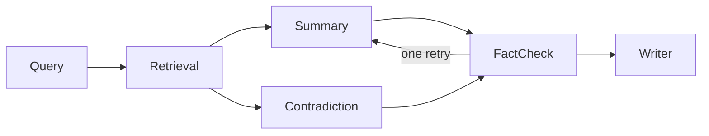

# Academic Research Assistant Team

Six agents turn a research question into a short, sourced literature summary. A claim stays in the summary only when a passage retrieved from the local papers supports it. The coordinator is a [Microsoft Agent Framework](https://learn.microsoft.com/en-us/agent-framework/) workflow. Each agent is one executor module. One `ResearchDossier` is the blackboard: every agent reads that object and writes its own fields. Chat goes through the Gemini Developer API. `OpeningDraft` only starts Summary and Contradiction together. It is not a seventh analyst.

A workflow fits because the steps are ordered, two of them can run at the same time, and the critic has one branch back to Summary. A blackboard fits because later agents need the earlier writes, and a private copy would let those writes drift. RAG fits because the passages are chunks of the supplied papers, and the fact-check gate refuses anything that is not copied from them.



`architecture.svg` is the same picture with the two tools on each agent.

## Roster

| Agent | Module | Tools | Writes on the dossier |
| --- | --- | --- | --- |
| Query | `agents/query_agent.py` | `list_corpus_titles`, `commit_subqueries` | 3–5 sub-queries over the paper titles |
| Retrieval | `agents/retrieval_agent.py` | `embed_subqueries`, `store_retrieved_passages` | passages for those sub-queries |
| Summary | `agents/summary_agent.py` | `read_passages_for_summary`, `commit_claims` | themed claims that name passage ids |
| Contradiction | `agents/contradiction_agent.py` | `read_passages_for_contradictions`, `commit_contradictions` | disagreements, or a note that none qualified |
| Fact-check | `agents/factcheck_agent.py` | `select_checkable_claims`, `commit_verdicts` | verdicts, and one retry flag |
| Writer | `agents/writer_agent.py` | `draft_supported_overview`, `publish_report` | the markdown report, with no model call |

The tools are plain Python functions wrapped as Agent Framework tools. The agent calls both on every visit. Summary's second visit does not repeat Contradiction.

## Memory and retrieval

The dossier holds the question, sub-queries, passages, claims, contradictions, verdicts, the dropped-claim log, and the report. The passage index holds one chunk per paper section and, when the embedding call works, one document vector per chunk. Ranking is `0.65 * max(cosine, 0) + 0.35 * lexical overlap`. Document embeddings use Gemini `RETRIEVAL_DOCUMENT`. Query embeddings use `RETRIEVAL_QUERY`. Only Retrieval reads the index.

## Honest failure

The fact-check model can mark a claim supported and attach a quote that is not in the cited passage. `commit_verdicts` drops that verdict. The claim is listed under dropped claims, and a rewrite is allowed only once. The model cannot restore it. A question the papers never mention, or a search that returns no passage, stops the run instead of inventing a source. Both stops are appended to `logs/run.log`. The file is only ever opened for append.

## Setup and run

Python 3.10 or newer. From this directory: `uv sync --extra dev`, then `cp .env.example .env`. Set `GOOGLE_API_KEY` (`GEMINI_API_KEY` is accepted). `GOOGLE_MODEL` defaults to `gemini-3.5-flash`, then `gemini-3.5-flash-lite` and `gemini-3.1-flash-lite` if Gemini is busy. `GOOGLE_EMBEDDING_MODEL` defaults to `gemini-embedding-2`.

```bash
uv run python -m research_assistant "Does retrieval-augmented generation reduce unsupported claims in scientific question answering?"
```

The command prints the summary, writes `outputs/<run_id>.md` and `outputs/<run_id>.json`, and appends `logs/run.log`. `--corpus PATH` selects another directory of `.md` or `.txt` papers. `uv run python -m research_assistant.ui` serves the same pipeline at <http://127.0.0.1:8765>.

`corpus/` has six short papers. Iyer 2025 reports that showing passages did not reduce unsupported claims. Okonkwo 2025 reports that requiring a passage id and a quote cut that rate from 31 percent to 6 percent.

## Demo, diagram, log, tests

`demo.ipynb` runs the workflow on two provided papers with a scripted model, so the trace does not need an API key. Run all cells, or `uv run python -m research_assistant.demo`. It prints each agent's tool calls, the summary, and the uncovered-question stop. `architecture.svg` is the diagram. `logs/run.log` is the append-only JSONL log. `uv run pytest` includes `tests/test_scenarios.py`: a supported summary, the critic's one retry, and the two stops against that log.
