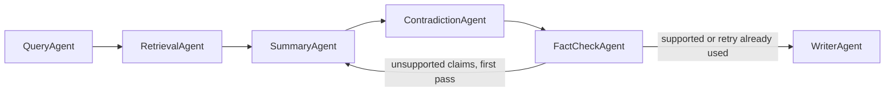

# Academic Research Assistant Team

A multi-agent system that turns a research question into a short, sourced literature summary. Every claim that remains in the summary maps to a passage retrieved from a local paper corpus. Unsupported claims are listed separately, and disagreements between sources are reported with both positions.

The coordination layer is [Microsoft Agent Framework](https://learn.microsoft.com/en-us/agent-framework/) (Python packages `agent-framework-core` and `agent-framework-gemini`). Chat and embeddings go through the Gemini Developer API. Agents are workflow executors. A typed dossier is the shared memory passed from one agent to the next. The passage index is built once and only the retrieval agent reads it.



## Agents

- **Query** (`agents/query_agent.py`) turns the question into 3–5 search sub-queries over the provided paper titles. It does not search the web.
- **Retrieval** (`agents/retrieval_agent.py`) fetches passages for each sub-query. Ranking blends positive embedding cosine with lexical overlap (`0.65 * max(cosine, 0) + 0.35 * lexical`). A passage with no word overlap and no positive similarity is dropped, so a query that matches nothing still stops the run. If embeddings fail, ranking falls back to lexical overlap. Document embeddings use Gemini's `RETRIEVAL_DOCUMENT` task, and query embeddings use `RETRIEVAL_QUERY`.
- **Summary** (`agents/summary_agent.py`) writes claims grouped by theme. Each claim names passage ids. On the first pass it runs at the same time as the contradiction check. On a critic retry it rewrites from the rejection notes, and the contradiction check is not repeated.
- **Contradiction** (`agents/contradiction_agent.py`) reports where two sources disagree and keeps both positions. Each side must cite different retrieved passages and include a quote copied from one of those passages. If nothing qualifies, the report says no contradiction was found.
- **Fact-check** (`agents/factcheck_agent.py`) is the critic. A claim is supported only when its passage ids are in the retrieved set and the supporting quote is copied from one of those passages. The gate is enforced in code, so a model verdict cannot restore a claim the gate rejected. If unsupported claims remain, the dossier returns to Summary once.
- **Writer** (`agents/writer_agent.py`) publishes the final summary without another model call. The overview is the supported claims themselves. Theme bullets include the paper title, passage id, and quote. Dropped claims, including ones removed during the retry, are listed underneath.

## Setup

Python 3.10 or newer. From this directory:

```bash
uv sync --extra dev
cp .env.example .env
```

Set `GOOGLE_API_KEY` in `.env`. `GEMINI_API_KEY` is accepted as an alias. `GOOGLE_MODEL` defaults to `gemini-3.8-flash`, and `GOOGLE_EMBEDDING_MODEL` defaults to `gemini-embedding-2` (`gemini-embedding-2-preview` is the other model the client accepts). `CHUNK_SIZE` and `CHUNK_OVERLAP` control how papers are split. `CHUNK_OVERLAP` must be smaller than `CHUNK_SIZE`.

## Run

```bash
uv run python -m research_assistant "Does retrieval-augmented generation reduce unsupported claims in scientific question answering?"
```

The command prints the summary and writes:

- `outputs/<run_id>.md` — themed summary, per-claim sources, contradictions, and dropped claims
- `outputs/<run_id>.json` — the dossier, from sub-queries through passages and verdicts

`--corpus PATH` selects a different directory of `.md` or `.txt` papers. The first line may be a `# Title`.

The run stops with an error, and does not invent sources, when the API key is missing, the corpus directory has no papers, or retrieval finds no passages.

## Page

```bash
uv run python -m research_assistant.ui
```

Opens a local page at [http://127.0.0.1:8765](http://127.0.0.1:8765). The form sends one question through the same pipeline and shows the overview, supported claims, contradictions, and dropped claims. The markdown and dossier files are still written under `outputs/`. `--port` chooses a different port.

## Demo corpus

`corpus/` holds six short original papers on retrieval for scientific question answering. Iyer 2025 reports that showing retrieved passages did not reduce unsupported claims. Okonkwo 2025 reports that requiring a passage id and a quote cut that rate from 31 percent to 6 percent. The contradiction agent is there to surface both positions.

## Tests

```bash
uv run pytest
```

Tests cover chunk ids, hybrid ranking (including an embedding that must not force a hit), the grounding gate, contradiction quotes, the overview gate, critic routing (one retry, then the writer, and a pass that needs no retry), and the dropped-claim list. They use a scripted completer and do not call the network. A bad setting such as `TOP_K=0` stops the command with `error:` instead of a traceback.
