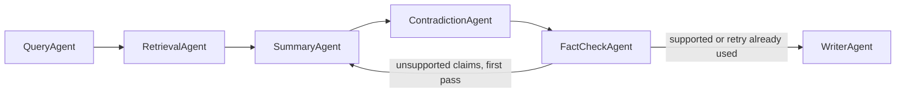

# Academic Research Assistant Team

A multi-agent system that turns a research question into a short, sourced literature summary. Every claim that remains in the summary maps to a passage retrieved from a local paper corpus. Unsupported claims are listed separately, and disagreements between sources are reported with both positions.

The coordination layer is [Microsoft Agent Framework](https://learn.microsoft.com/en-us/agent-framework/) (Python packages `agent-framework-core` and `agent-framework-openai`). Agents are workflow executors. A typed dossier is the shared memory passed from one agent to the next. The passage index is built once and only the retrieval agent reads it.



## Agents

- **Query** (`agents/query_agent.py`) turns the question into 3–5 search sub-queries over the provided paper titles. It does not search the web.
- **Retrieval** (`agents/retrieval_agent.py`) fetches passages for each sub-query. Ranking blends embedding cosine with lexical overlap, and falls back to lexical overlap if embeddings fail.
- **Summary** (`agents/summary_agent.py`) writes claims grouped by theme. Each claim names passage ids. On a critic retry it rewrites from the rejection notes.
- **Contradiction** (`agents/contradiction_agent.py`) reports where two sources disagree and keeps both positions. Each side must cite different retrieved passages. If nothing qualifies, the report says no contradiction was found.
- **Fact-check** (`agents/factcheck_agent.py`) is the critic. A claim is supported only when its passage ids are in the retrieved set and the supporting quote is copied from one of those passages. The gate is enforced in code, so a model verdict cannot restore a claim the gate rejected. If unsupported claims remain, the dossier returns to Summary once.
- **Writer** (`agents/writer_agent.py`) publishes the final summary. Theme bullets are rendered from supported claims only, with paper title, passage id, and quote. Dropped claims, including ones removed during the retry, are listed underneath.

## Setup

Python 3.10 or newer. From this directory:

```bash
uv sync --extra dev
cp .env.example .env
```

Set `OPENAI_API_KEY` in `.env`. `OPENAI_BASE_URL` is optional and is for an OpenAI-compatible gateway. `OPENAI_CHAT_MODEL_ID` and `OPENAI_EMBEDDING_MODEL` override the default models.

## Run

```bash
uv run python -m research_assistant "Does retrieval-augmented generation reduce unsupported claims in scientific question answering?"
```

The command prints the summary and writes:

- `outputs/<run_id>.md` — themed summary, per-claim sources, contradictions, and dropped claims
- `outputs/<run_id>.json` — the dossier, from sub-queries through passages and verdicts

`--corpus PATH` selects a different directory of `.md` or `.txt` papers. The first line may be a `# Title`.

The run stops with an error, and does not invent sources, when the API key is missing, the corpus directory has no papers, or retrieval finds no passages.

## Demo corpus

`corpus/` holds six short original papers on retrieval for scientific question answering. Iyer 2025 reports that showing retrieved passages did not reduce unsupported claims. Okonkwo 2025 reports that requiring a passage id and a quote cut that rate from 31 percent to 6 percent. The contradiction agent is there to surface both positions.

## Tests

```bash
uv run pytest
```

Tests cover chunk ids, hybrid ranking, the grounding gate, critic routing (one retry, then the writer), contradiction passage ids, and the dropped-claim list. They use a scripted completer and do not call the network.
